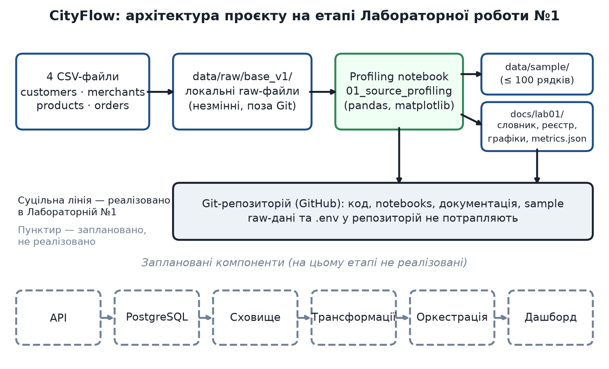

# CityFlow Data Engineering (student S08)

Навчальний проєкт з дисципліни «Методи та технології інженерії даних» (ЛНУ ім. І. Франка, ФЕП-34). Студент: Полянський Тимотей, `student_id = S08`.
Предметна область — сервіс міських замовлень і доставки **CityFlow**: клієнти, партнерські заклади, товари, замовлення та їхні позиції.
Проєкт розвивається етапами; тут — Лабораторні роботи №1 (профілювання джерел) та №2 (PostgreSQL: завантаження, цілісність, транзакції).

## Джерела даних
| Пакет | Файли | Каталог |
|---|---|---|
| `cityflow_S08_base_v1.zip` | customers, merchants, products, orders | `data/raw/base_v1/` |
| `cityflow_S08_lab02_relational_v1.zip` | order_items (+ payments, refunds, couriers, deliveries, service_zones — у Лабі 2 не завантажуються) | `data/raw/lab02_relational/` |

SHA-256 архівів і файлів — у `docs/package_checksums.json`. Raw-дані **не** входять до Git; у `data/sample/` лежать малі синтетичні вибірки.

## Схема проєкту (Architecture v0)


Суцільні лінії — реалізоване в Лабі 1 (CSV → `data/raw/` → ноутбук профілювання → документація; Git зберігає код і документи, але не raw-дані). Пунктир — заплановані компоненти (API, база даних, сховище, трансформації, оркестрація, дашборд).

## Структура
```text
data/raw/ (поза Git), data/sample/lab01/
notebooks/lab01/01_source_profiling.py|.ipynb   # профілювання (jupytext: .py ↔ .ipynb)
src/lab02/{db,ingest,validate,pipeline}.py      # staging, правила приймання, публікація core
sql/lab02/{01_ddl,02_checks}.sql
tests/lab02/                                     # правила (без БД) і надійність (з PostgreSQL)
scripts/                                         # підготовка raw, схеми, збір метрик, генерація звітів
docs/lab01/  docs/lab02/  docs/package_checksums.json  docs/report_meta.json
```

## Встановлення й запуск
Потрібні: Python 3.14 (див. `.python-version`), [uv](https://docs.astral.sh/uv/), Docker, `typst` (лише для PDF).
```fish
uv sync                                    # залежності з uv.lock
cp .env.example .env                       # змініть пароль; .env у Git не потрапляє
uv run python scripts/prepare_raw.py <каталог-або-zip-з-архівами-S08>
fish scripts/rebuild_all.fish              # усе: Лаба 1 → PostgreSQL → Лаба 2 → звіти
```
Окремо: `uv run jupytext --to notebook --execute notebooks/lab01/01_source_profiling.py` (Restart & Run All);
`docker compose up -d`; `docker compose exec -T postgres psql -v ON_ERROR_STOP=1 -U cityflow_user -d cityflow_s08 < sql/lab02/01_ddl.sql`;
`uv run python -m src.lab02.pipeline`; `uv run pytest tests -v`.

Змінні конфігурації (без секретів): `DATA_RAW_PATH`, `POSTGRES_HOST/PORT/DB/USER/PASSWORD`, `STUDENT_ID`.
Версії (фактичні, з останнього запуску): Python 3.14.7, pandas 3.0.6, psycopg 3.3.6, PostgreSQL сервер 16.15 і клієнт `psql` 16.15 (образ `postgres:16-alpine`).

## Політика Лаби 2
Повний **snapshot**: у транзакції очищуються лише `core.*` (без `CASCADE`) і вставляється прийнятий набір; `stg` і `audit` зберігаються. Правила приймання — `docs/lab02/load_policy.md`, відповідність колонок — `docs/lab02/source_to_target.md`. Кожен CSV-запис має один статус у `audit.row_decisions`; звірка кількостей, ключів і сум окремо за валютою виконується в тій самій транзакції.

## Висновки та обмеження
1. Ключі й grain чотирьох файлів підтверджено; повторення ключів — лише повні дублікати.
2. Проблеми джерел (відсутні батьки, `UA H`, не-ISO дати, нульова ціна активного товару, пробіли) не виправляються вручну, а обробляються явними правилами з обліком.
3. Core публікується атомарно; повторний запуск не змінює бізнес-стан, збій відкочується, `FAILED` зберігається в журналі.
4. Суми `orders` і `order_items` рахуються й звіряються окремо за валютою; прямий JOIN завищує суми.
5. Обмеження: лише повний snapshot (без UPSERT/SCD); `payments`, `refunds`, `couriers`, `deliveries`, `service_zones` не завантажуються; швидкодія не вимірювалась.

Використання ШІ описано в `AI_USAGE.md`.
